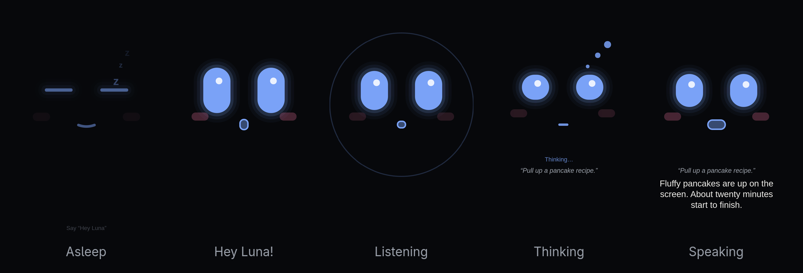
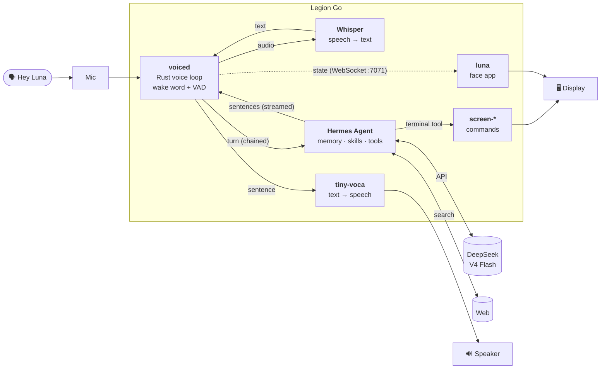
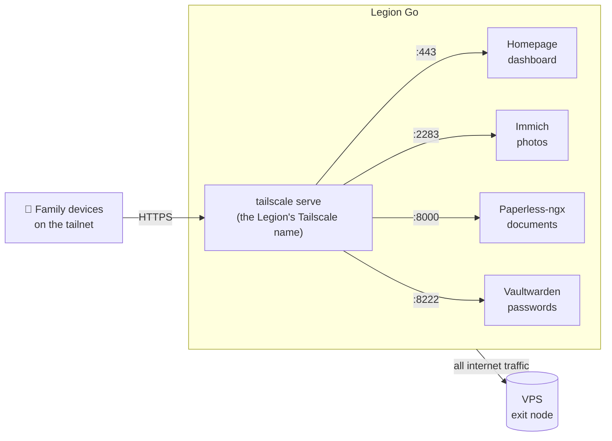
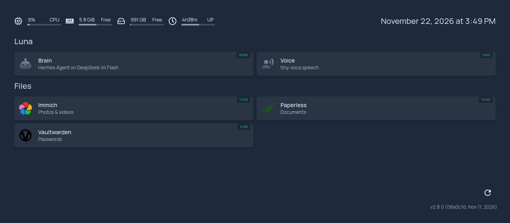

# Legion home server and Luna



▶️ **[Watch Luna in action](docs/media/luna-promo.mp4)** (6 seconds, with sound)

A Lenovo Legion Go running [Omarchy](https://omarchy.org), set up as the
house's always-on box. It does two jobs:

1. **Luna, the voice assistant.** Say **"Hey Luna"** and talk to her. She
   answers out loud, looks things up, puts pages on the screen and takes them
   away, keeps the conversation going without the wake word, and fixes her own
   problems over time.
2. **Home server.** Photos, documents and passwords for the family, reachable
   only over Tailscale, with a dashboard at the root address.

Everything runs as the `legion` user (rootless Podman and systemd user
services). Nothing listens on the local network.

## How it fits together





## At a glance

`legion.<tailnet>.ts.net` is the Legion's Tailscale name and `<legion-host>` its
Tailscale name or IP; the real values live only in the `.env` files on the
Legion.

| What | Where |
|---|---|
| Dashboard | `https://legion.<tailnet>.ts.net` |
| Immich (photos) | `https://legion.<tailnet>.ts.net:2283` |
| Paperless-ngx (documents) | `https://legion.<tailnet>.ts.net:8000` |
| Vaultwarden (passwords) | `https://legion.<tailnet>.ts.net:8222` |
| Luna | the Legion itself: "Hey Luna" |
| Luna on / off | `ssh legion@<legion-host> '~/homelab/lunactl start'` (or `stop`, `status`); see [operations](docs/operations.md#turn-luna-on-and-off) |
| SSH | `ssh legion@<legion-host>` (Tailscale) |
| Logins | `~/homelab/CREDENTIALS.txt` on the Legion (never committed) |

<table>
<tr>
<td width="38%" valign="top">
<br>
<sub>"Hey Luna, pull up a pancake recipe." She finds one, shows it full-screen
(ad-blocked), and says what's on screen. "Close that" brings her face back.</sub>
</td>
<td width="62%" valign="top">
<br>
<sub>The dashboard at the root address: live status for Luna's brain and voice,
Immich, Paperless and Vaultwarden, plus CPU, memory, disk and uptime.</sub>
</td>
</tr>
</table>

## Docs

| | |
|---|---|
| [Luna, the voice assistant](docs/voice-assistant.md) | Talking to her, voiced, the wake word, Hermes, the screen, the face, how she improves herself |
| [Architecture](docs/architecture.md) | Every piece and port, the request flow, the state machine, networking |
| [Services](docs/services.md) | Immich, Paperless, Vaultwarden, the dashboard, tiny-voca, Tailscale |
| [System setup](docs/system.md) | Battery cap, never sleeping, no lock screen, mic levels, ad blocking, Podman |
| [Operations](docs/operations.md) | Status, logs, restarts, changing things, updates, backups, problems we've hit |
| [Decisions](docs/decisions.md) | Why it's built this way, and what was tried and dropped |

## This repo

`~/homelab` on the Legion is the repo: compose files, the voice loop's source
(`voiced/`), Luna's face app (`luna/`) and the tiny-voca service (`tts/`). Files
that live elsewhere on the system (screen commands, systemd units, root-owned
config, Luna's self-written skills) are copied into `live/` by `./collect`:

```sh
cd ~/homelab
./lunactl status         # Luna on or off (start, stop, enable, disable)
./collect                # snapshot the live config into live/
git status && git diff   # see what changed, including anything Luna changed
git add -A && git commit -m "Describe the change"
```

The `.gitignore` is an allow-list: only the files it names can be committed, so
`.env` files, `CREDENTIALS.txt`, API keys, photos, databases and models stay
out. Models and weights are downloaded by `voiced/models/fetch` and `tts/fetch`.
