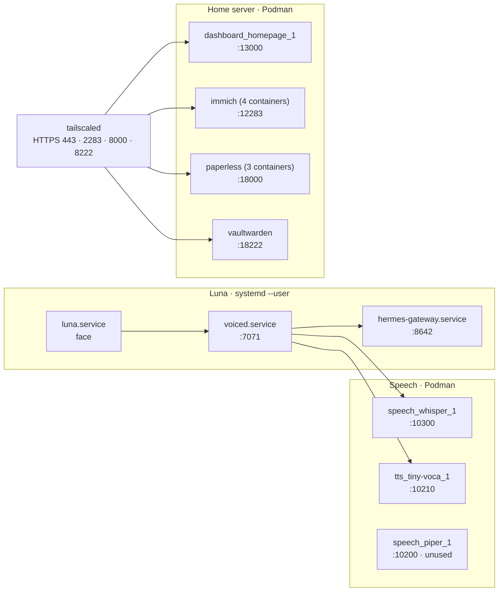
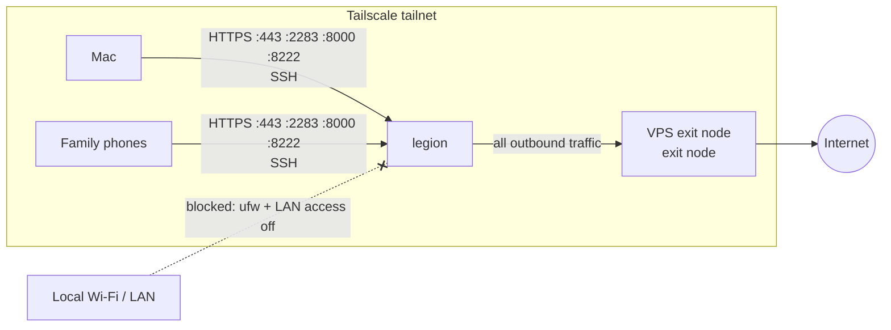

# Architecture

## Hardware

Lenovo Legion Go (8APU1): AMD Ryzen Z1 Extreme, 16 threads, 16 GB RAM (12 GB
usable, the rest reserved for the GPU), 1 TB SSD, 8.8" portrait touchscreen
(800x1280, Hyprland scale 1.25, so 640x1024 logical), built-in mic array and
speakers. It stays plugged in, with the battery capped at about 80%.

OS: Omarchy (Arch Linux + Hyprland), kernel 7.2.

## Pieces

| Piece | Runs as | Listens on | Source |
|---|---|---|---|
| voiced (voice loop) | user service `voiced.service` | 127.0.0.1:7071 (state WebSocket) | `voiced/` |
| luna (face) | user service `luna.service`, package `luna` | client of :7071 | `luna/` |
| Hermes Agent gateway | user service `hermes-gateway.service` | 127.0.0.1:8642 (API) | `~/.hermes/hermes-agent` |
| Whisper (speech to text) | container `speech_whisper_1` | 127.0.0.1:10300 (Wyoming) | `speech/` |
| Piper (spare TTS, unused) | container `speech_piper_1` | 127.0.0.1:10200 (Wyoming) | `speech/` |
| tiny-voca (text to speech) | container `tts_tiny-voca_1`, host network | 127.0.0.1:10210 (HTTP) | `tts/` |
| Homepage dashboard | container, host network | 127.0.0.1:13000 | `dashboard/` |
| Immich | 4 containers | 127.0.0.1:12283 | `immich/` |
| Paperless-ngx | 3 containers | 127.0.0.1:18000 | `paperless/` |
| Vaultwarden | 1 container | 127.0.0.1:18222 | `vaultwarden/` |
| Tailscale | system service | tailnet HTTPS 443, 2283, 8000, 8222 | — |

Every port above is on `127.0.0.1`; only `tailscaled` faces outward, and only to
the tailnet. The dashboard polls each service (and Hermes and tiny-voca) for its
status card, and `podman-restart.service` starts all containers at boot.

## How a voice request flows

A step-by-step sequence diagram is in
[the voice assistant doc](voice-assistant.md#one-request-end-to-end).

1. `voiced` reads the mic continuously (`pacat`, 16 kHz mono, 80 ms chunks) and
   runs openWakeWord (melspectrogram, then embeddings, then the `hey_luna`
   model) on every chunk. It uses a few percent of one core and about 50 MB of RAM.
2. On "Hey Luna" it plays a rising chime and records until Silero VAD hears
   about 0.8 s of silence.
3. The audio goes to Whisper (`small-int8`, English) over the Wyoming protocol.
4. The text goes to Hermes' Responses API (`/v1/responses`, streaming), chained
   to the previous turn with `previous_response_id`, so Hermes keeps the whole
   conversation including its own tool calls. The request's instructions say
   what is on the screen right now.
5. Hermes thinks with DeepSeek V4 Flash and may call tools: web search, the
   terminal (which runs the `screen-*` commands), memory and skills.
6. As each sentence of the reply arrives, `voiced` sends it to tiny-voca and
   plays the audio, so Luna starts talking before Hermes has finished.
7. For 8 seconds after she finishes, `voiced` listens again without the wake
   word. Silence, or "thanks Luna", "that's all", "never mind", ends the
   conversation with a falling chime. After 5 quiet minutes the next "Hey
   Luna" starts a fresh conversation.

Throughout, `voiced` broadcasts its state (`idle`, `wake`, `listening`,
`thinking` with the tool name, `heard` with the transcript, `speaking` with the
sentence) on `ws://127.0.0.1:7071`, and the face app draws it.

## Network

- **Tailscale** is the only way in. Each service is published with
  `tailscale serve --https=<port> http://127.0.0.1:<internal port>`, so it gets
  a real certificate for `legion.<tailnet>.ts.net` and is reachable only from
  the tailnet. `live/tailscale-serve.txt` has the current mapping.
- **Exit node:** the Legion sends its internet traffic through
  `VPS exit node` with LAN access off, because it
  started out on public Wi-Fi. Turn it off with `tailscale set --exit-node=`.
- **ufw** is on and blocks inbound. Rootless Podman publishes ports only on
  `127.0.0.1`, so the firewall is never bypassed.
