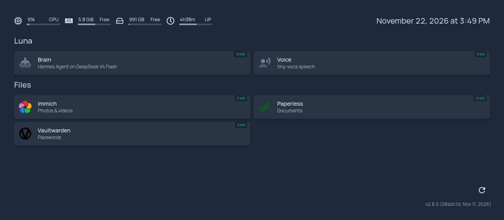

# Services

All run as rootless Podman containers under `legion`, started with
`podman-compose up -d` in their folder, and come back after a reboot through
`podman-restart.service` (user). Each binds to `127.0.0.1` only and is
published over Tailscale HTTPS. Logins are in `~/homelab/CREDENTIALS.txt`.

| Service | URL | Internal | Folder |
|---|---|---|---|
| Homepage dashboard | https://legion.<tailnet>.ts.net | 13000 | `dashboard/` |
| Immich | https://legion.<tailnet>.ts.net:2283 | 12283 | `immich/` |
| Paperless-ngx | https://legion.<tailnet>.ts.net:8000 | 18000 | `paperless/` |
| Vaultwarden | https://legion.<tailnet>.ts.net:8222 | 18222 | `vaultwarden/` |

## Dashboard (Homepage)



[Homepage](https://gethomepage.dev) at the root address: a "Luna" group (her
brain, Hermes, and her voice, tiny-voca) and a "Files" group, each card with a
live response time, plus CPU, memory, disk, uptime and a clock. Config
in `dashboard/config/` (`services.yaml`, `widgets.yaml`, `settings.yaml`).
Runs with host networking on 127.0.0.1:13000 so its status checks can reach
the other services' loopback ports.

## Immich (photos)

Official compose file and `.env` from the Immich release. Photos in
`immich/library/`, database in `immich/postgres/`. First account created in
the web UI becomes the admin. Mobile apps connect to
`https://legion.<tailnet>.ts.net:2283` over Tailscale.

## Paperless-ngx (documents)

Postgres + Redis + webserver. The admin account comes from `.env`. Data, media,
export and consume folders are Podman named volumes (rootless Podman and
Paperless' user mapping clash on bind mounts). English OCR.

## Vaultwarden (passwords)

Bitwarden-compatible. Data in `vaultwarden/data/`. Sign-ups are on so the
family can create accounts; turn them off afterwards
(`SIGNUPS_ALLOWED: "false"` in the compose file, then
`podman-compose up -d`). Admin page at `/admin` with the token in `.env`.
Bitwarden apps and extensions use the server URL
`https://legion.<tailnet>.ts.net:8222`.

## Speech (Whisper, Piper)

`speech/`: Wyoming servers. Whisper (`small-int8`, English) does Luna's
speech to text on 10300. Piper (10200) is left from the first setup and is not
used by Luna; it can be removed.

## tiny-voca (Luna's voice)

`tts/`: a tiny HTTP service around [tiny-voca](https://github.com/n4ze3m/tiny-voca)
(4.5M parameters, Apache-2.0). It runs the ONNX model with onnxruntime and
the `dizione` phonemizer; no PyTorch. `POST /speak {"text", "voice":
"F2"|"M2", "speed"}` returns a 24 kHz WAV. Four sentences take about 50 ms.
Build with `podman-compose build` after `./fetch`.

## Tailscale

```sh
tailscale serve status                                        # current mapping
tailscale serve --bg --https=<port> http://127.0.0.1:<internal>   # add one
tailscale serve --https=<port> off                            # remove one
```
