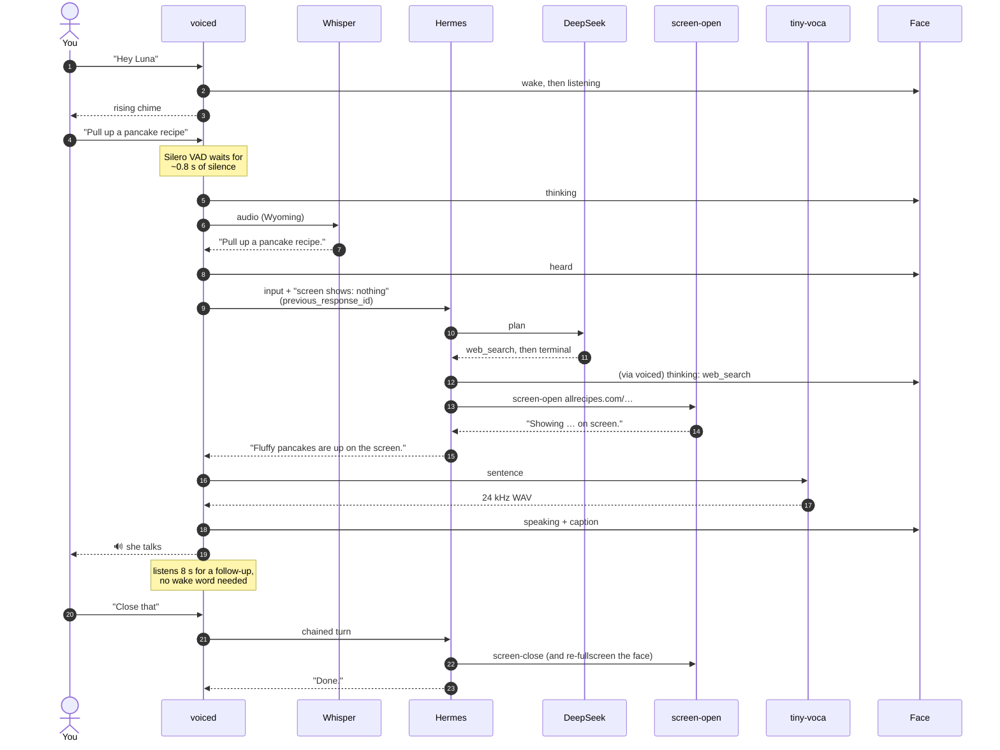
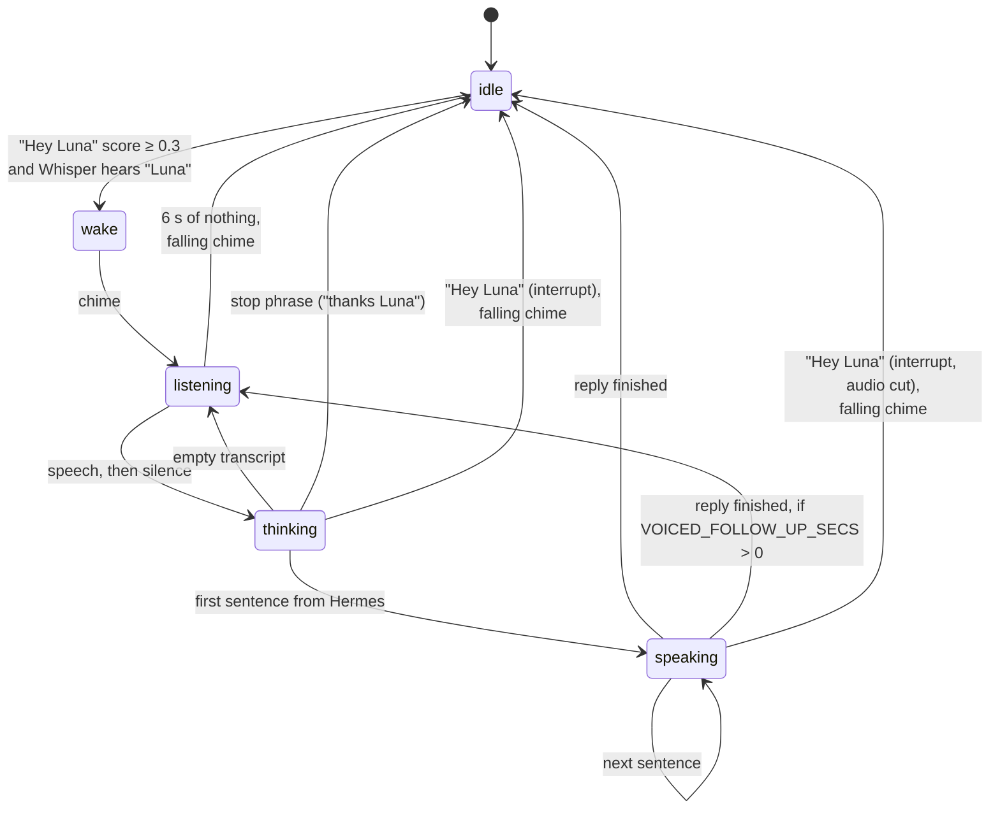
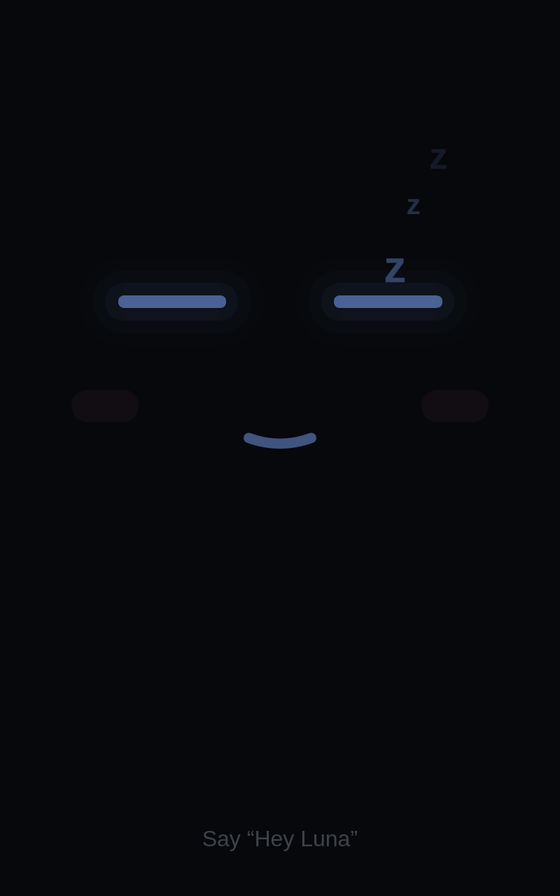
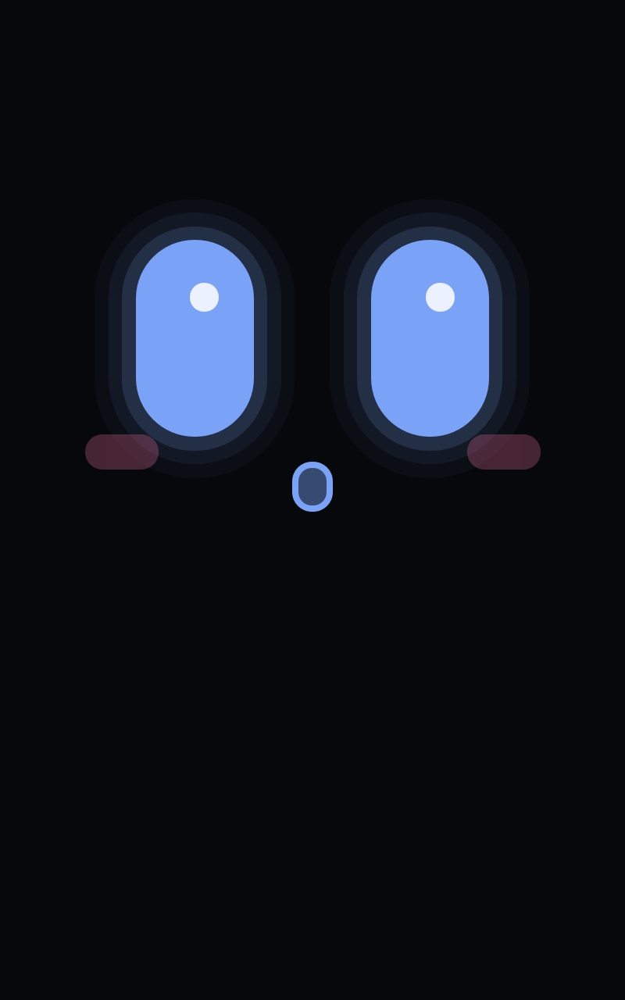
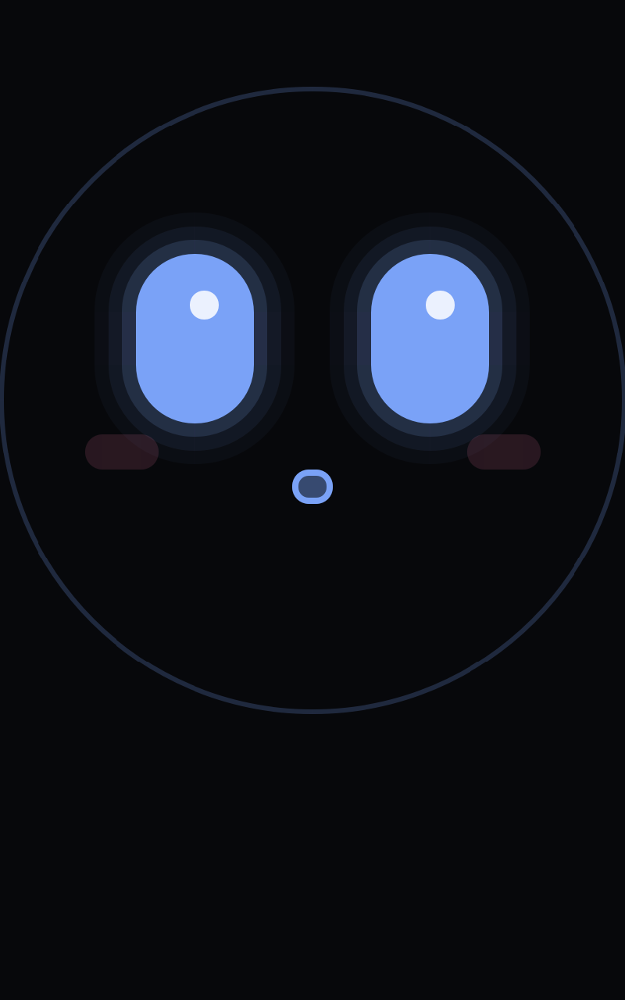
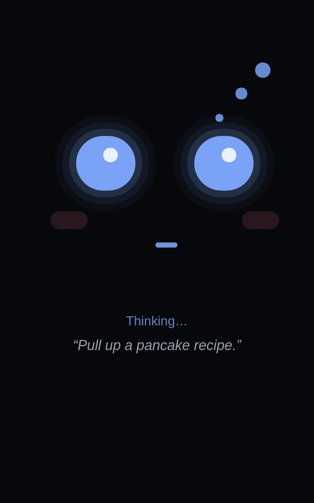
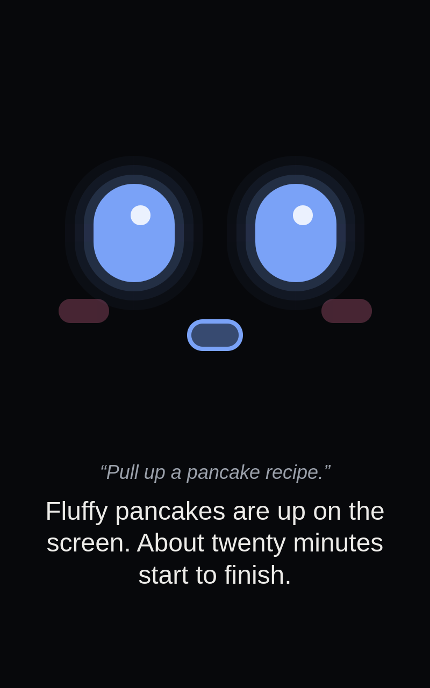

# Luna, the voice assistant

Luna is four small programs and an agent:

| Part | Job |
|---|---|
| `voiced` (Rust) | Hears "Hey Luna", records you, runs the conversation, speaks |
| Whisper | Turns your speech into text |
| Hermes Agent + DeepSeek V4 Flash | Understands, answers, uses tools, remembers |
| tiny-voca | Turns her words into speech |
| `luna` (Qt) | Her face on the screen |

## Talking to her

- "Hey Luna", then ask. You'll hear a rising chime when she's listening.
- One request per "Hey Luna": when she has answered she goes back to sleep.
  (A follow-up window without the wake word can be turned on with
  `VOICED_FOLLOW_UP_SECS`, but in a busy house it mostly catches other people.)
- "thanks Luna", "bye Luna", "that's all", "never mind" end it too; silence
  after the chime gives the falling chime.
- Cut her off any time she is thinking or talking with "Hey Luna" (e.g. "Hey
  Luna, cancel"): she stops at once, plays the falling chime and goes back to
  sleep. Whatever you say after it is ignored; say "Hey Luna" again to ask
  something new.
- "Pull up a pancake recipe" puts a page on the screen; "close that" takes it
  away. "No thanks" to an offer leaves it up.

## One request, end to end



## voiced's states

These are what the face draws. `heard` carries the transcript and `thinking`
can carry the tool Hermes is using.



An interrupt doesn't listen for a command: anything after "Hey Luna" might
be the TV, so she just stops and sleeps until the next "Hey Luna".

### Interrupting

- **Audio:** each sentence plays in its own `pacat`; an interrupt kills it, so
  she stops mid-word (well under 0.5 s; one 80 ms mic chunk plus the wake model).
- **Hermes:** `voiced` stops reading the stream and drops the connection.
  Hermes notices on its next write (it sends keepalives while a tool runs),
  interrupts the agent and stores an `incomplete` snapshot. The next turn is
  chained to that cancelled turn, so Hermes still knows what it had already
  done (e.g. a page it opened). If that chaining fails, `voiced` retries once
  from the last finished turn.
- **Screen:** a cancel doesn't touch the screen. A tool already running when
  you cancel (say `screen-open`) may still finish; the next turn's "screen
  shows" line tells her, and "close that" takes it away.
- **Her own voice:** played through the speakers, her saying "Hey Luna" scores
  0.90 at the mic, so a higher threshold alone can't stop her waking herself.
  While she talks (and 1.5 s after) the threshold is `VOICED_BARGE_THRESHOLD`,
  and while she says "Luna" (and 1.5 s after) the wake word is ignored. For
  real echo removal she goes through PipeWire's WebRTC echo canceller (below):
  with it her own "Hey Luna" scored 0.001 and her speech left no voice
  activity at all, while the same clip from someone else still scored 0.90.

### Echo cancellation

`~/.config/pipewire/pipewire-pulse.conf.d/luna-echo-cancel.conf` (copied to
`live/pipewire/`) loads `module-echo-cancel` (WebRTC) whenever
`pipewire-pulse` starts. It adds `luna_ec_source` (the mic with her voice
removed) and `luna_ec_sink` (her speakers, which the canceller listens to),
both on top of the default mic and speakers. The system defaults don't change,
so other apps are unaffected. `voiced.service` sets
`VOICED_MIC=luna_ec_source VOICED_SPEAKER=luna_ec_sink`, so her chimes and
speech go through the canceller.

The canceller's speaker stream comes up at about 1% volume (and WirePlumber
saves that), which made her nearly silent. `voiced.service` runs
`~/.local/bin/luna-ec-volume` (copied to `live/bin/`) before every start to set
it to 100%. voiced restarts whenever `pipewire-pulse` does, so this also covers
audio restarts.

WebRTC's noise suppression is turned off too: it muffled speech enough to
cut a "Hey Luna" from 0.88 (raw mic) to 0.68, barely above the threshold;
without it the cancelled mic scored 0.89. Echo removal doesn't need it: her own
"Hey Luna" still scored 0.001 on the cancelled mic (0.89 on the raw one).

WebRTC's automatic gain control is turned off (`aec_args` in that file):
when it was on it pushed the mic hardware to maximum (capture 63, boost 2),
the near-clipping setting that once stopped "Hey Luna" triggering (see
[operations](operations.md)). The levels stay at capture 45, boost 1.

`audio-duck` (`~/.local/bin`, run by `audio-duck.service`, written by Luna)
turns other playback down to 22% while she speaks. Her voice now reaches the
speakers as the `Echo-Cancel Playback` stream, so the script skips that stream
by name; otherwise it ducks Luna herself.

Only her own audio is removed: a video playing on the screen still reaches
the mic as before.

To turn it off, remove that `Environment=` line, then
`systemctl --user daemon-reload && systemctl --user restart voiced`
(and delete the drop-in and `systemctl --user restart pipewire-pulse` to drop
the devices).

## voiced

Source: `voiced/src/`. Build with `cargo build --release` in `voiced/`; the
service runs `voiced/target/release/voiced`.

| File | What it does |
|---|---|
| `main.rs` | Config, Luna's instructions (`SYSTEM`), stop phrases, the conversation loop, test modes |
| `audio.rs` | Mic capture and playback through `pacat`; the chimes |
| `speaker.rs` | Speaks a reply on its own thread so it can be cut off; picks the wake threshold while she talks |
| `wake.rs` | openWakeWord streaming pipeline (reads any model's tensor names) |
| `vad.rs` | Silero VAD v5 |
| `wyoming.rs` | Minimal Wyoming client for Whisper |
| `hermes.rs` | Streams Hermes' Responses API; splits sentences; drops markdown, URLs and echoed shell commands |
| `events.rs` | State WebSocket on 127.0.0.1:7071 |
| `onnx.rs` | Shared ONNX Runtime environment |

Settings are environment variables (set them in `voiced.service`):

| Variable | Default |
|---|---|
| `VOICED_WAKE_MODEL` | `hey_luna` (any `.onnx` in `voiced/models/`) |
| `VOICED_WAKE_THRESHOLD` | `0.3` (low, because Whisper confirms every wake) |
| `VOICED_BARGE_THRESHOLD` | `0.5` (wake threshold while she is talking) |
| `VOICED_MIC` / `VOICED_SPEAKER` | PipeWire defaults (set to the echo-cancel source and sink) |
| `VOICED_VOICE` | `F2` (tiny-voca's other voice is `M2`) |
| `VOICED_FOLLOW_UP_SECS` | `0` (off; seconds to keep listening without the wake word) |
| `VOICED_VERIFY_WAKE` | `1` (check each wake with Whisper; `0` to skip) |
| `VOICED_WAKE_WHISPER` | same as `VOICED_WHISPER`; `voiced.service` sets `127.0.0.1:10301` (tiny model) |
| `VOICED_MAX_REQUEST_SECS` | `8` |
| `VOICED_REASONING` | `low` (DeepSeek reasoning for voice turns: `none`, `low`, `medium`, `high`, `max`) |
| `VOICED_WHISPER` / `VOICED_TTS` / `VOICED_HERMES` | local defaults |

Test modes, no microphone needed:

```sh
# Wake word score for a 16 kHz s16le mono recording (plus the Whisper check)
voiced/target/release/voiced --test-wake clip.raw
# Where recording a request would stop (optionally given your wake-word level)
voiced/target/release/voiced --test-record clip.raw [level]
# Typed turns through Hermes exactly as voice would, with what's on screen after each
PATH=~/.local/bin:$PATH voiced/target/release/voiced --test-chat "Pull up a pancake recipe." "Close that."
```

## A noisy house

Like Alexa, Luna has to pick one person out of a room of talking, TV and
banging. What she does about it:

| Problem | Fix |
|---|---|
| Her own voice | Echo cancellation (above) |
| TV and chatter set off the wake word | Second-stage check: when the wake model fires, Whisper transcribes the last ~2 s and she only wakes if it heard "Luna" (or "lunar", "loona"...). Rejections are logged as `wake rejected (score …, whisper heard "…")`. Alexa does the same check in the cloud. |
| Background talk taken as follow-ups | Follow-up window off by default (Alexa ships it off too) |
| A video or other people recorded as your request | Your "Hey Luna" sets your level (mean of its three loudest 80 ms chunks, logged as `your level`). Recording only starts on speech within 9 dB of it, so quieter voices across the room don't start it |
| Recording never stops because the room is never silent | A pause is no speech *or* 14 dB quieter than your "Hey Luna" (you are closer than everyone else), and a request stops after 8 s |
| Saying "Hey Luna" twice cancels the request | Interrupts only count once she has started answering, or after 4 s of thinking |

Tested on a real 90 s recording of the living room (a Minecraft video playing
on another device, two "Hey Luna"s at wake scores 0.85 to 0.90): starting
right after the first "Hey Luna" it recorded the second one (1.5 s) and stopped
before the video; on the video alone it recorded nothing, where the old logic
took 4.7 s of the video as the request. `--test-record clip.raw <level>` takes
a level to try this.

Tested offline (`--test-record`) with a 2.7 s request and constant chatter:
recording stopped 0.5 s after the request with chatter 10 to 15 dB below it,
and at the 8 s cap with chatter almost as loud (it used to run to 20 s).

The wake threshold is 0.3 (it was 0.5): real "Hey Luna"s from across the room
peaked at 0.35 and 0.42 and were missed, while successful ones scored 0.52 to
0.89. False triggers at the lower threshold are caught by the Whisper check.
Before checking, voiced waits for the score to peak (at most ~320 ms) so
Whisper hears the whole "Luna"; after a rejection it ignores the same sound for
1.5 s rather than resetting the wake model, so a real "Hey Luna" still being
said isn't thrown away. Near misses are logged at their peak.

The wake check uses `VOICED_WAKE_WHISPER`: the `whisper-fast` container in
`speech/docker-compose.yml` (the `tiny` model on 127.0.0.1:10301, set in
`voiced.service`). On 2 s clips it answered in 0.22 to 0.27 s, against 1.1 to
1.5 s for the main `small` model, and heard "Hey Luna" just as reliably. It runs with
`--initial-prompt "Hey Luna."`: without it the tiny model once heard a real
"Hey Luna" as "Hey, woman" and rejected it. With the prompt, chatter and
ordinary requests still never came out as "Luna" in tests. The last rejected
clip is kept in `/tmp/voiced-rejected-wake.raw` (try it with `--test-wake`),
and near misses (peaks of 0.2 up to the threshold) are logged as `near miss`. If it
is down, wakes are let through unchecked rather than ignored. Start it with
`cd ~/homelab/speech && podman-compose up -d whisper-fast` (rootless Podman,
no sudo).

The biggest improvement left is hardware: a USB speakerphone with a mic array
(it steers toward the speaker, like Alexa's seven mics) and a louder speaker.
Point `VOICED_MIC` / `VOICED_SPEAKER` at it.

## Wake word

"Hey Luna" is a community openWakeWord model from
[fwartner/home-assistant-wakewords-collection](https://github.com/fwartner/home-assistant-wakewords-collection).
On synthetic speech it scored 0.87 (female voice) and 0.85 (male), with
unrelated speech and "the luna moth flew by" at 0.001; the threshold is 0.3 (see A noisy house).
To switch, download another model's `.onnx` into `voiced/models/`, set
`VOICED_WAKE_MODEL`, and restart. A custom word means training one (see
[decisions](decisions.md)).

## Hermes

Hermes Agent (Nous Research), installed with `omarchy-install-hermes-cli`, at
`~/.hermes/hermes-agent`, updated with `hermes update`.

- Model: `deepseek-v4-flash` via provider `deepseek`; key `DEEPSEEK_API_KEY`
  in `~/.hermes/.env`.
- API server on 127.0.0.1:8642 (`API_SERVER_ENABLED=true`,
  `API_SERVER_KEY` in `~/.hermes/.env`; `voiced` reads it from there).
- `live/hermes/config.yaml` is the config without secrets;
  `live/hermes/env-variables.txt` lists which variables are set.

### Images

`agent.image_input_mode: text`: when Luna looks at a picture (`vision_analyze`),
DeepSeek describes it in a side call and only that description joins the
conversation. In the default native mode the raw base64 image is stored in the
replayed history, where Hermes' secret redaction can corrupt it; DeepSeek then
rejects every later turn of that conversation with `Invalid base64 data`.

If a request is rejected before she has said anything, voiced retries from the
last finished turn and then in a fresh conversation, so a bad stored history
costs one retry instead of failing until the 5-minute history timeout.

### Reasoning

Hermes' own default is `agent.reasoning_effort: none`. voiced asks for `low`
on every voice turn (`model_options.reasoning_effort` in the request, set by
`VOICED_REASONING`), so only Luna's spoken turns think. Tested on the same
questions:

| Question | none | low | medium |
|---|---|---|---|
| Sandwiches for 3 kids, one away | right, 1.3 s | right, 1.4-1.7 s | |
| Chicken timer vs dinner time | **wrong**, 1.4 s | right, 6.5 s (208 chars of thinking) | right, 4.6 s (682 chars) |
| Who is second youngest | right, 1.2 s | right, 2.0 s | right, 1.6 s |

`low` thinks briefly (34 to 208 characters here); simple questions cost a few
tenths of a second. Time to first words varies a lot with DeepSeek's load, so
single timings are rough.

Luna's personality and rules live in `SYSTEM` in `voiced/src/main.rs`: who she
is, short spoken answers, how to use the screen, to trust the "screen shows"
line over memory, and to say plainly why something failed and how to fix it.

## The screen

Hermes drives the display with four commands in `~/.local/bin` (copied to
`live/bin/`):

| Command | Does |
|---|---|
| `screen-open <url>` | Full-screen Chromium app window, in its own profile (`~/.local/share/jarvis-screen`) so your own browser is never touched; replaces whatever she had open |
| `screen-close` | Kills that profile's windows, then re-fullscreens the face |
| `screen-text "<text>"` | Big text page (each line a row) |
| `screen-list` | Windows on screen; Luna's are tagged `[luna]` |
| `screen-env` | Sourced by the others to reach the Hyprland session from a service |

uBlock Origin Lite is force-installed in Chromium by policy, so pages she
opens have no ads.


<sub>What "Hey Luna, pull up a pancake recipe" looks like on the Legion.</sub>

## The face

`luna` is an Omarchy-style Qt Quick app (`luna/` in this repo),
installed as the `luna` package with a launcher entry and `luna.service`.
Original character: two glowing capsule eyes in the Omarchy accent color,
soft cheeks, a small mouth.

| Asleep | Hey Luna! | Listening | Thinking | Speaking |
|:---:|:---:|:---:|:---:|:---:|
|  |  |  |  |  |
| Resting smile; after 20 s of quiet she dozes: slit eyes, drifting z's, dimmed | Eyes pop open with a bounce | Wide eyes, small "o" mouth, pulsing ring | Eyes glance around, thought bubbles, "Searching the web…", your words in quotes | Mouth moves, each sentence as a caption |

If `voiced` isn't running, the face says so. Keys (with a keyboard): Space
previews moods, F full screen, ? shortcuts, Q quit.
`luna snapshot <state> out.png` renders a mood offscreen.

## How she improves herself

Hermes can edit files and write skills, and Luna does. So far she has:

- written `screen-luna-fullscreen` and called it from `screen-close`, because
  closing a page left her face un-fullscreened;
- added a Hyprland window rule (`luna-fullscreen`) to `~/.config/hypr/hyprland.lua`;
- written the skill `household-display-control` (`live/hermes/skills/`).

Run `./collect` and `git diff` to see what she has changed since the last
commit. If a change is bad, restore the file from `live/` and tell her why.
