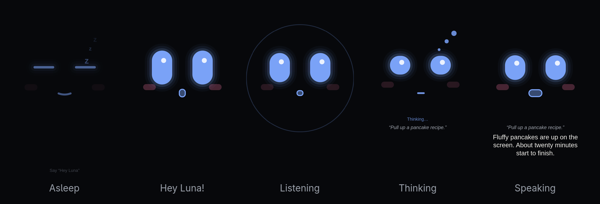

# Luna



Luna's face. A full-screen animated face for the family voice assistant: she
dozes while idle, perks up on "Hey Luna", listens, glances around while she
thinks, and talks with captions. It follows the Omarchy theme's accent color.

The face only shows what `voiced` (the voice loop) reports over
`ws://127.0.0.1:7071`. If voiced isn't running, the face says so.

## Shortcuts

| Key | Action |
|-----|--------|
| Space | Preview Luna's moods |
| F | Full screen on or off |
| ? | Show or hide shortcuts |
| Q | Quit |

## Build and run

```sh
bin/build && build/luna
bin/test
bin/install                       # installs the package, launcher entry and user service
systemctl --user enable --now luna  # start with the desktop
luna snapshot listening out.png   # render one mood offscreen (asleep, idle, wake, listening, thinking, speaking)
luna record frames/               # render the scripted promo offscreen, frame by frame
```
